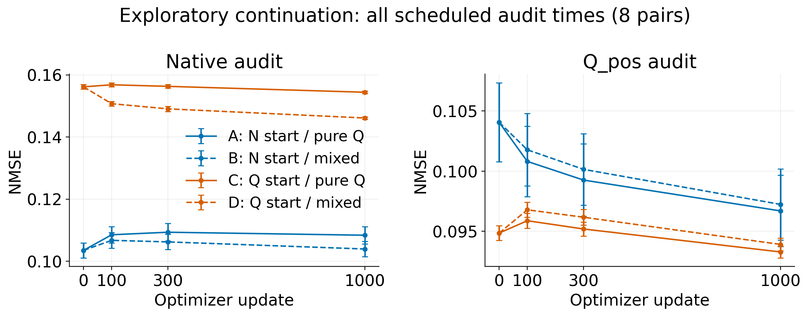

# Supplementary Material

## Appendix A. Research sequence and provenance

### A.1 Development and scientific freezes

Silent Teacher progressed from a token-wise MLP task to full-block learning, synthetic qualification, WikiText/PG-19 development, and held-out PG-19 confirmation. Its confirmation set is historically spent. Subsequent ID1, ID2, XR1, and CMR1 studies each froze construction rules, random roles, target selection, and scientific decision criteria after the preceding evidence became available.

Each formal Q_pos target ledger contains 1024 length-128 windows from each of C4, peS2o, and StackExchange. Deterministic predecessor-exposure exclusions preserve the campaign-specific retained identities. The ledgers differ; Pythia also uses a different tokenizer. A frozen record's NOT_RUN state refers to the freeze date, with completed results recorded separately.

Pythia-160M uses revision `50f5173d932e8e61f858120bcb800b97af589f46`, weight SHA-256 `29d2e457a664e41c12c735f20a36dc0956a665f614a54ce5db21a32e75965270`. Its parallel residual configuration uses RoPE fraction 0.25/base 10000 and LayerNorm epsilon 1e-5. All formal Students are terminal checkpoints at 10,000 updates. Original receipts identify Teacher weights, Student parameters, construction roles, and input hashes.

### A.2 Existing evidence versions

The following Git versions identify the records used here. Result versions and content hashes identify the evidence; the curated public archive is prepared but remains unpublished at this version's preparation date.

| Evidence | Git version |
|---|---|
| Silent Teacher confirmation results | `0d6a0fe7f5ebff429c0861264a9c2046d5856c04` |
| ID1 report / erratum | `f6ee4f9409f32824134fcaf7bda0a6ad9183b4c3` / `e23ffc010911083ddd119747ea35a80d11856735` |
| ID2 formal results | `fd8b2f073b5dc24244c2615126ed52fffe65c996` |
| XR1 formal results | `a603c6e1b62532b53902209da0a29ed12582bec8` |
| CMR1 comparison / evaluation implementation | `6e1cddecfd47fd0f613ff6eb50c7974ffbdfe925` / `1485bbe52767c02fd93e48d10564779b138422e1` |
| Training-support diagnostics | `56fe0fc9fe1c10d45f7688dd9517b099a593dc2a` |
| Cross-support diagnostics | `91e280115b8b21b7277daa8678efabd326ab30dd` |
| Functional-response diagnostics | `eb0338f76ca823df07c2e7c65d07b67e87c6c015` |
| Short continuation | `13bec5abe3d6a14286e0966cf7218339e6ab486c` |

Formal aggregate-result SHA-256 identities are:

| Campaign | SHA-256 |
|---|---|
| ID2 | `1ce0085a2eb82b16e15ed1cbbee21fd6ea2944ac6911c0ba120b1c3287decd7f` |
| XR1 | `529b1768933d910974319e2fa7719362e9ee933146d2af8f031c695156d612c5` |
| CMR1 | `0fcd19b492d95df1a5010019df3b80319e520940f7c12c6ba305b6ec541552cc` |

### A.3 Execution and exposure boundaries

**Silent Teacher and early qualification.** The early B0 numerical qualification failed (0.05000536 > 0.05), followed by a procedural waiver and deterministic selection repair. Later full-block confirmation is separate evidence. After held-out Value outcomes, the Context/causality evaluator required a memory-bounded streaming repair. Equivalence was checked before use on 1600 realized windows (maximum difference 1.57e-13, tolerance 1e-12); data, donors, checkpoints, definitions, and criteria were unchanged.

**ID1.** A secondary-key failure required a repair and repeat evaluation. Both executions and a later wording erratum remain in the historical record. The NLL point-estimate direction agreed with Value/KL; Context differed.

**ID2.** A gate bug launched both replicate-01 arms before the intended execution tag. Outcomes were not inspected, and unchanged-seed replay was bit-identical. A pre-outcome driver completed the evaluator stub. Following target evaluation, an analysis-persistence failure was recovered from the same immutable metrics, with 41 bit-exact comparisons and zero mismatches.

**XR1.** Training-control incidents required gate repairs. Evaluation v8 aborted after transient first-Student/first-environment metrics that were neither persisted nor exposed as scientific outcomes. Repaired v9 retained all 48 valid Student records without recomputing valid persisted records.

**CMR1.** Qualification and RNG-control revisions occurred before the scientific freeze. An overbroad review search exposed historical target metadata but no example bodies, labels, model outputs, or target scores. The archived assessment records a procedural access violation without assessed outcome contamination; canonical selection remained unchanged. An alternative unauthorized qualification root was transient and not adopted. The production Teacher wrapper was repaired before formal training.

These events qualify the execution history and observed exposure, while superseded runs remain outside the formal replicate counts.

## Appendix B. Feasibility and earlier intervention

### B.1 Historical feasibility and endpoint definitions

The held-out PG-19 confirmation used 3196 windows and 405,892 scored tokens with seeds 501-503. Native passed the original Value, pooled-query Context, and predictive-KL criteria in all three seeds, yielding HELDOUT_CONFIRMED_REPLICATED. Context pooled the two query numerators and denominators within the environment before division, unlike the equal-query formal endpoint used in ID2/XR1/CMR1. Lower KL indicates closer whole-model predictions after block replacement; NLL measures language-model quality and can move differently.

**Table B1. Complete historical feasibility scores.** Lower is better. The Gaussian own-audit column evaluates its independent synthetic support; the other columns evaluate the held-out target. Values use the persisted precision, rounded to six decimals.

| Seed | Native Value | Native Context | Native KL | Gaussian own-audit Value | Gaussian target Value | Gaussian target Context | Gaussian KL |
|---|---:|---:|---:|---:|---:|---:|---:|
| 501 | 0.698391 | 0.756193 | 0.115437 | 0.267775 | 2.895546 | 1.117745 | 1.033124 |
| 502 | 0.672299 | 0.702185 | 0.119684 | 0.287235 | 3.073787 | 1.166020 | 1.046195 |
| 503 | 0.666047 | 0.729700 | 0.115233 | 0.287701 | 3.213844 | 1.166658 | 1.080099 |

TokenWise controls have Context 1 and target Value 0.724212-0.730071. The parameter-copy control has Value 0.868789 and Context 0.690712, illustrating different fidelity profiles: it has a lower Context error than Native but worse Value and predictive KL. These controls establish partial transfer rather than exact operator recovery.

### B.2 Earlier intervention and terminal fitting

For ID1, let \(z^A,z^B\) be iid token-ID donors and \(c=64\). The coherent and composite arms are

\[
H^+=G(z^A_{<c},z^B_{\ge c}),\qquad
H^-=(G(z^A)_{<c},G(z^B)_{\ge c}).
\]

Causality makes their first-half hidden states identical. Their second halves arise from different preceding token contexts. Both receive fresh full-block Teacher labels. This is not a permutation of one finite hidden bank, so ID1's small effect cannot be treated as a lesser dose of the precisely controlled ID2 intervention.

The later exploratory training-support review covered 240 formal arm curves across ID2/XR1/CMR1. Terminal own-support dev means (Native / Q_pos) were 0.102917 / 0.095970, 0.077021 / 0.074322, and 0.041004 / 0.041029. These compare different supports and Teacher-energy denominators. Curves remained declining near their terminal region; finite stable records do not establish convergence. Neither lower diagonal NMSE nor continued decline alone identifies the source of ID2's cross-support deficit.

## Appendix C. Same-column cross-support differences

**Table C1. Paired Q_pos-trained-minus-Native-trained error on each common dev support.** Ranges are replicate minima and maxima, not intervals for an expectation. All original formal pairs are included.

| Campaign | Support column | Mean difference | Sample SD | Range | Positive pairs |
|---|---|---:|---:|---|---:|
| ID2 | Native | +0.053840 | 0.002857 | +0.048937 to +0.061634 | 48/48 |
| ID2 | Q_pos | −0.007323 | 0.003491 | −0.015187 to +0.001565 | 1/48 |
| XR1 | Native | +0.001236 | 0.001662 | −0.002881 to +0.004067 | 19/24 |
| XR1 | Q_pos | −0.003840 | 0.001558 | −0.007695 to −0.001151 | 0/24 |
| CMR1 | Native | +0.001387 | 0.001033 | −0.000756 to +0.004257 | 42/48 |
| CMR1 | Q_pos | −0.001885 | 0.001221 | −0.004251 to +0.001672 | 2/48 |

Per-replicate records preserve raw SSE, Teacher energy, bank and checkpoint identities. Both Students share the same denominator within a column. GPT-2 Teacher scoring uses the historical batch size 32 and Student scoring size 8; CMR1 uses size 8 for both. The entire recomputed diagonal agreed with historical terminal dev values within 1e-9.

## Appendix D. Donor-aligned response and exact error geometry

### D.1 Definitions and negative controls

At Q_pos row \(j\), position \(t\), the Native donor is \(\pi_t(j)\). Define

\[
\delta T_{jt}=T(H_Q[j])_t-T(H_N[\pi_t(j)])_t,
\quad
\delta S_{jt}=S(H_Q[j])_t-S(H_N[\pi_t(j)])_t.
\]

The query vector is bitwise identical, positions and masks match, and changed future positions cannot affect a causal query. This differs from the formal target Context splice: all positions of the synthetic row are recombined, with the query compared to its own position-specific donor. Both are functional responses, but they use different interventions and supports.

Because the paired query input is identical, its residual-update response equals its full-block-output response. On identical inputs, Student–Teacher update error likewise equals block-output error. Nevertheless, response reproduction and final error remain distinct measurements: for one Student, \(\delta S-\delta T=e(H_Q[j])_t-e(H_N[\pi_t(j)])_t\). Thus response reproduction is a paired difference of its errors on two supports, not independent evidence of a causal mechanism.

For each replicate the public denominator is \(E_N=\sum_{jt}\|T(H_N[j])_t\|^2\). Both Students, both supports, and all decomposition terms share it. Position-specific summaries use the corresponding Native energy \(E_{N,t}\); group summaries pool numerators and denominator before dividing. Reported values average replicate-level ratios. Raw response energy is the squared norm per query vector, not per scalar coordinate. Relative response reproduction error is \(\sum\|\delta S-\delta T\|^2/\sum\|\delta T\|^2\). Gain is \(\langle\delta S,\delta T\rangle/\|\delta T\|^2\) and cosine uses all response vectors flattened together, rather than averaging local cosines.

At \(t=0\), the same Teacher or Student has zero response difference because there is no earlier history. For Pythia, the directly query-dependent MLP branch has zero response difference at every position. Both references were exactly zero in the completed batch. They do not require equality of outputs from two *different* Students. Checks covered input identity, permutation bijections, labels, interfaces, masks, positional machinery, and algebraic closure.

The initial GPT-2 smoke used Teacher batch size 8 and failed the label-identity check (maximum difference 1.0681e-4). Restoring historical size 32 yielded exact labels without relaxing tolerance. FP32 forwards and stored update sums were retained; differences and inner products used FP64. Vector closure tolerance was 2e-5, relative SSE closure 1e-6, and the two-Student identity tolerance 1e-12. Small FP32 accumulation residues were recorded, not discarded. The archived suite reports 121 passing tests after this repair. Complete position summaries include all 128 positions plus the fixed t=0/63/127 references; no favorable query positions were selected after inspection.

### D.2 Teacher intervention strength and Student responses

**Table D1. Teacher response energy (mean ± sample SD).** Raw energy is per 768-dimensional query vector. The normalized value divides pooled energy by the corresponding Native Teacher-update energy. This is neither formal target Context nor the Cross-Support Q_pos-column NMSE denominator.

| Campaign | Position group | Raw energy | Relative to Native Teacher energy |
|---|---|---:|---:|
| ID2 | all positions | 80.771 ± 0.498 | 0.201133 ± 0.001169 |
| ID2 | 63 | 79.983 ± 2.401 | 0.244596 ± 0.007234 |
| ID2 | 127 | 64.436 ± 2.365 | 0.199660 ± 0.007138 |
| XR1 | all positions | 268.047 ± 2.572 | 0.132458 ± 0.001227 |
| XR1 | 63 | 274.961 ± 11.068 | 0.131109 ± 0.004582 |
| XR1 | 127 | 218.677 ± 10.492 | 0.103969 ± 0.005159 |
| CMR1 | all positions | 15.868 ± 1.042 | 0.116186 ± 0.007369 |
| CMR1 | 63 | 16.725 ± 1.322 | 0.116462 ± 0.008057 |
| CMR1 | 127 | 16.596 ± 1.136 | 0.109945 ± 0.007006 |

ID2 has the largest normalized response strength, while XR1 has the largest raw strength. These answer different scaling questions and do not determine Student learning difficulty.

**Table D2. Overall donor-aligned response reproduction.** Error is relative to Teacher response energy; gain and cosine have the definitions above. Parentheses give sample SDs. Numbers are not target Context scores.

| Campaign | Student | Relative response error | Projection gain | Cosine |
|---|---|---:|---:|---:|
| ID2 | Native | 0.252638 (0.019425) | 0.748623 (0.016884) | 0.864443 (0.011248) |
| ID2 | Q_pos | 0.477392 (0.020856) | 0.521098 (0.019338) | 0.722778 (0.014662) |
| XR1 | Native | 0.185215 (0.011385) | 0.813856 (0.011602) | 0.902636 (0.006353) |
| XR1 | Q_pos | 0.176972 (0.011691) | 0.821584 (0.011112) | 0.907190 (0.006442) |
| CMR1 | Native | 0.187793 (0.012579) | 0.808871 (0.011725) | 0.901214 (0.007007) |
| CMR1 | Q_pos | 0.184643 (0.015409) | 0.816821 (0.014254) | 0.902940 (0.008571) |

At the preselected positions 63 / 127, ID2 relative errors are Native 0.246924 / 0.272729 and Q_pos 0.466508 / 0.537749. XR1 values are Native 0.170322 / 0.176229, Q_pos 0.163245 / 0.165972; CMR1 values are Native 0.188454 / 0.202034, Q_pos 0.186832 / 0.199748. The Q_pos disadvantage in ID2 is not confined to the pooled result. At t=0, response errors are zero and relative error/cosine are undefined, not assigned zero as if they were measured ratios.

### D.3 Serial and parallel decompositions

For GPT-2 define

\[
\begin{aligned}
a&=A_S(H)-A_T(H),\\
m&=M_S(H+A_T(H))-M_T(H+A_T(H)),\\
p&=M_S(H+A_S(H))-M_S(H+A_T(H)).
\end{aligned}
\]

Then \(e=S(H)-T(H)=a+m+p\), and

\[
\|e\|^2=\|a\|^2+\|m\|^2+\|p\|^2
+2\langle a,m\rangle+2\langle a,p\rangle+2\langle m,p\rangle.
\]

Here \(m\) evaluates the Student MLP at the Teacher attention intermediate state for diagnosis; it does not replace the Student's actual forward pass. \(p\) measures how the Student's attention deviation changes its subsequent MLP input and output. This is an exact algebraic decomposition in real arithmetic, not a unique allocation of causal loss.

For Pythia, \(a=A_S(H)-A_T(H)\), \(m=M_S(H)-M_T(H)\), and \(e=a+m\), so the norm expansion has two squared terms and one doubled inner product. There is no serial propagation term.

**Tables D3–D5. Full-output error decomposition.** Each entry is *raw pooled SSE or doubled inner product in millions; normalized value using E_N*. Columns denote Student → input support. Values are replicate means, not ratios of mean raw energies. Cross terms can be negative; squared norms cannot be summed alone to recover full error. Rounding and archived FP32 summation residues explain small displayed closure discrepancies.

**Table D3. ID2.**

| Term | N → N | Q → N | N → Q | Q → Q |
|---|---:|---:|---:|---:|
| attention squared | 4.014204; 0.305056 | 4.523972; 0.343792 | 3.685635; 0.280087 | 3.430739; 0.260713 |
| fixed-state MLP squared | 4.511930; 0.342874 | 4.340246; 0.329831 | 4.365149; 0.331721 | 4.109671; 0.312308 |
| propagation squared | 0.593324; 0.045091 | 0.680148; 0.051686 | 0.584322; 0.044406 | 0.561473; 0.042668 |
| 2〈a,m〉 | −6.615998; −0.502770 | −6.155106; −0.467748 | −6.224216; −0.472997 | −5.796474; −0.440494 |
| 2〈a,p〉 | −0.901920; −0.068548 | −1.139152; −0.086566 | −0.710807; −0.054025 | −0.639745; −0.048616 |
| 2〈m,p〉 | −0.247270; −0.018786 | −0.187353; −0.014238 | −0.401265; −0.030489 | −0.458919; −0.034875 |
| full error | 1.354269; 0.102917 | 2.062756; 0.156757 | 1.298818; 0.098703 | 1.206745; 0.091705 |

**Table D4. XR1.**

| Term | N → N | Q → N | N → Q | Q → Q |
|---|---:|---:|---:|---:|
| attention squared | 15.746770; 0.237479 | 16.484172; 0.248592 | 15.231714; 0.229709 | 15.596392; 0.235204 |
| fixed-state MLP squared | 18.035616; 0.271982 | 17.169850; 0.258926 | 17.883137; 0.269685 | 16.957251; 0.255721 |
| propagation squared | 0.970747; 0.014641 | 1.053769; 0.015893 | 0.971983; 0.014659 | 1.000253; 0.015085 |
| 2〈a,m〉 | −27.782527; −0.418978 | −27.461882; −0.414138 | −27.140661; −0.409298 | −26.804228; −0.404221 |
| 2〈a,p〉 | −2.243989; −0.033855 | −3.537007; −0.053350 | −2.017098; −0.030431 | −3.161020; −0.047679 |
| 2〈m,p〉 | 0.380652; 0.005752 | 1.480429; 0.022334 | 0.104187; 0.001581 | 1.197471; 0.018066 |
| full error | 5.107270; 0.077021 | 5.189330; 0.078257 | 5.033263; 0.075905 | 4.786119; 0.072176 |

**Table D5. CMR1 parallel block.**

| Term | N → N | Q → N | N → Q | Q → Q |
|---|---:|---:|---:|---:|
| attention squared | 0.953070; 0.213000 | 1.036619; 0.231667 | 0.959827; 0.214511 | 1.031419; 0.230505 |
| MLP squared | 1.026059; 0.229313 | 1.104260; 0.246789 | 1.026059; 0.229313 | 1.104260; 0.246789 |
| 2〈a,m〉 | −1.795646; −0.401309 | −1.951186; −0.436064 | −1.792999; −0.400719 | −1.951270; −0.436082 |
| full error | 0.183483; 0.041004 | 0.189693; 0.042392 | 0.192887; 0.043105 | 0.184409; 0.041211 |

For ID2 on Native support, the normalized Q-minus-N changes are +0.038736 in attention squared, −0.013043 in fixed-state MLP squared, +0.006596 in propagation squared, and +0.035022/−0.018018/+0.004548 in the three cross terms. The *net propagation-associated* change, including both cross terms involving p, is −0.006874, despite its positive squared-term change. This prevents attributing the total extra error to a standalone propagation loss. CMR1's same-Student MLP squared error is identical across supports by the full-vector column invariant, but different Students can have different MLP errors. Their error compensation differs as well.

The Q_pos full-error numbers in these tables are not the Q_pos column of Table 4. Here both supports use E_N; Table 4 uses each column's own Teacher energy. For example, ID2's Q-column difference is −0.006998 here and −0.007323 in Cross-Support. Both are valid under their declared denominators.

### D.4 Output disagreement and direction

Let \(e_N=S_N-T\) and \(d=S_Q-S_N\) on the same input. Exactly,

\[
\|S_Q-T\|^2-\|S_N-T\|^2=\|d\|^2+2\langle e_N,d\rangle.
\]

**Table D6. Two-Student identity on pooled dev inputs.** Means normalized by E_N, with sample SDs in parentheses. The disagreement term is nonnegative; the directional term need not be.

| Campaign | Support | Disagreement | Directional cross term | Final error difference |
|---|---|---:|---:|---:|
| ID2 | Native | 0.088504 (0.003039) | −0.034664 (0.004404) | 0.053840 (0.002857) |
| ID2 | Q_pos | 0.037939 (0.003012) | −0.044936 (0.005606) | −0.006998 (0.003336) |
| XR1 | Native | 0.025893 (0.001274) | −0.024657 (0.002432) | 0.001236 (0.001662) |
| XR1 | Q_pos | 0.025478 (0.001227) | −0.029207 (0.002338) | −0.003729 (0.001513) |
| CMR1 | Native | 0.013716 (0.001996) | −0.012329 (0.002098) | 0.001387 (0.001033) |
| CMR1 | Q_pos | 0.013997 (0.002160) | −0.015891 (0.002359) | −0.001894 (0.001227) |

These identities describe error geometry. They do not assign causal roles to either term or identify an independent mediator.

## Appendix E. ID2 short-horizon cross-continuation

### E.1 Fixed local intervention

Replicates 01–08 were selected by index before continuation, without screening target outcomes or diagnostic quality. Each historical terminal checkpoint seeded two branches: A, Native start → pure Q_pos; B, Native start → 0.9 Q_pos + 0.1 Native; C, Q_pos start → pure Q_pos; D, Q_pos start → the same mixture. All 32 branches ran exactly 1000 updates, with audit scoring at 0/100/300/1000 and donor-aligned dev diagnostics at 0/1000. All times are reported; the audit did not select a checkpoint.

Before any smoke updates, historical train/dev/audit banks (4096/256/512 rows) were reconstructed with their original frozen roles and matched donor, permutation, hidden, and Teacher-label hashes. No substitute audit was generated. Step-0 scoring was reproducible, and the response/decomposition baseline exactly reproduced each selected replicate's first-stage diagnostic.

AdamW state was reset to empty at every branch. Other optimizer settings were retained, but a fixed 50-step warmup to 3e-4 and cosine decay to 3e-5 replaced the old schedule. The historical terminal learning rate was actually 1e-4, not zero. Each update used 32 Student forward samples and four microbatches of eight. Pure branches used two independent Q_pos batches of 16 with weights 0.5/0.5; mixed branches used Q_pos and Native batches of 16 with weights 0.9/0.1. This explicitly estimates the complete-bank weighted MSE objective, without row replacement or a claim of a marginal-preserving mixed minibatch. All index streams were frozen before training. Updates and forward samples were matched, but gradient variance, supervision information, and number of Q_pos samples were not identical.

Actual training totals were 32,000 updates, 1,024,000 forward samples, and 128,000 Student microbatch forwards, excluding the separate eight-update smoke. Thirty-eight archived tests passed. Continuation artifacts remained separate from historical checkpoints; no formal target score was computed.

### E.2 All scheduled audit results

**Table E1. Audit trajectories and full-training-support objective.** NMSE is mean ± sample SD across eight pairs. SSE columns are replicate means in millions. Each audit column has its own frozen denominator shared across branches. Objective values are MSE averaged over each branch's complete original training supports with its specified weights, not normalized errors. Result identity is recorded in Appendix A.

| Branch | Step | Native NMSE | Q_pos NMSE | Native SSE(M) | Q_pos SSE(M) | Training-objective MSE |
|---|---:|---:|---:|---:|---:|---:|
| A | 0 | 0.103499 ± 0.002394 | 0.104059 ± 0.003288 | 2.724014 | 2.617068 | 0.051088 |
| A | 100 | 0.108525 ± 0.002591 | 0.100812 ± 0.002938 | 2.856303 | 2.535395 | 0.049271 |
| A | 300 | 0.109338 ± 0.002811 | 0.099260 ± 0.003013 | 2.877698 | 2.496358 | 0.048336 |
| A | 1000 | 0.108375 ± 0.002805 | 0.096698 ± 0.002967 | 2.852365 | 2.431935 | 0.046923 |
| B | 0 | 0.103499 ± 0.002394 | 0.104059 ± 0.003288 | 2.724014 | 2.617068 | 0.051165 |
| B | 100 | 0.106727 ± 0.002534 | 0.101779 ± 0.003012 | 2.808965 | 2.559708 | 0.050199 |
| B | 300 | 0.106225 ± 0.002481 | 0.100151 ± 0.002963 | 2.795771 | 2.518785 | 0.049335 |
| B | 1000 | 0.103940 ± 0.002510 | 0.097238 ± 0.002962 | 2.735618 | 2.445517 | 0.047818 |
| C | 0 | 0.156142 ± 0.000713 | 0.094856 ± 0.000616 | 4.109563 | 2.385630 | 0.045492 |
| C | 100 | 0.156805 ± 0.000648 | 0.095882 ± 0.000623 | 4.127012 | 2.411422 | 0.046012 |
| C | 300 | 0.156297 ± 0.000559 | 0.095196 ± 0.000586 | 4.113622 | 2.394168 | 0.045675 |
| C | 1000 | 0.154399 ± 0.000403 | 0.093287 ± 0.000486 | 4.063672 | 2.346157 | 0.044720 |
| D | 0 | 0.156142 ± 0.000713 | 0.094856 ± 0.000616 | 4.109563 | 2.385630 | 0.048992 |
| D | 100 | 0.150702 ± 0.000694 | 0.096789 ± 0.000623 | 3.966391 | 2.434248 | 0.049606 |
| D | 300 | 0.149056 ± 0.000867 | 0.096174 ± 0.000653 | 3.923062 | 2.418765 | 0.049260 |
| D | 1000 | 0.146111 ± 0.000410 | 0.093912 ± 0.000516 | 3.845548 | 2.361879 | 0.048093 |

**Figure E1. Fixed-horizon continuation.** All four branches and all preselected times are shown. Points and bars are mean ± one sample SD across eight replicates; connecting segments guide the eye and do not assert intermediate measurements. Blue denotes the Native start, orange the Q_pos start; solid denotes pure Q_pos, dashed the mixed objective. The two panels have different audit denominators and are interpreted within a panel. Data come exclusively from the persisted continuation summary.

**Table E2. End-minus-baseline audit changes.** Mean ± sample SD of paired changes, not differences of unpaired error bars. Positive means worse. Both supports improve in all eight C and D runs; Native audit worsens in all eight A and B runs.

| Branch | Native change | Q_pos change |
|---|---:|---:|
| A | +0.004877 ± 0.000762 | −0.007361 ± 0.000700 |
| B | +0.000441 ± 0.000275 | −0.006821 ± 0.000703 |
| C | −0.001744 ± 0.000325 | −0.001569 ± 0.000145 |
| D | −0.010031 ± 0.000415 | −0.000944 ± 0.000115 |

Compared with same-start pure continuation, B−A and D−C Native-column differences are −0.004436 and −0.008288 at step 1000 (all eight pairs negative), with Q_pos-column costs +0.000540 and +0.000625 (all eight positive). No registered preservation tolerance applies to these costs. Native-column starting-point gaps remain +0.046023 for C−A and +0.042171 for D−B, versus +0.052643 initially. Pure Q_pos continuation does not remove the historical Q Student's Native deficit; the mixture changes it more but does not restore the historical Native baseline. Both C and D improve both supports relative to their baselines, so a local relative tradeoff is not proof that improvement on Native must worsen initial Q_pos performance or that a hard capacity limit has been reached.

### E.3 Functional changes and nonmediation boundary

**Table E3. Step-0 → step-1000 donor-aligned dev response reproduction.** These are the fixed eight-replicate subset, not the 48-pair means in Table D2.

| Branch | Relative response error | Projection gain | Cosine |
|---|---:|---:|---:|
| A | 0.257428 → 0.261398 | 0.745224 → 0.734690 | 0.861658 → 0.859333 |
| B | 0.257428 → 0.241351 | 0.745224 → 0.759731 | 0.861658 → 0.870925 |
| C | 0.470617 → 0.468417 | 0.527092 → 0.530045 | 0.727592 → 0.729099 |
| D | 0.470617 → 0.455699 | 0.527092 → 0.540927 | 0.727592 → 0.737780 |

The mixed Native-start branch B improves response error, gain, and cosine in all eight replicates while slightly worsening Native audit in all eight. C/D improvements are accompanied by final-error improvements but do not demonstrate a causal mediator. On Native dev inputs, all four branches reduce the attention, fixed-state MLP, and propagation squared norms on average, while weakening negative attention–MLP compensation. For A, attention and MLP squared changes −0.010887/−0.022761 coexist with a +0.037910 attention–MLP cross-term change and a +0.004867 full-error change (normalized by dev E_N). For D, attention squared changes by −0.014076, the same cross term by +0.010894, and full error by −0.010026. Audit and dev are independent supports, so their similar directions are not identical measurements. All terms and cross terms remain in the archived summaries.

Extra optimization, support-specific supervision, and starting-point effects coexist within this short local intervention; their independent contributions remain unresolved.

## Appendix F. Elementary theoretical clarification

Consider a scalar query \(x\) and a preceding scalar \(z\). Native's four-row bank is two copies each of \((z,x)=(-1,-1)\) and \((1,1)\). Independently permuting the history column can produce all four sign combinations once while preserving both finite column multisets. Let \(T(z,x)=x\), independent of history, and restrict the Student to \(S_w(z,x)=wz\). The complete-bank risks are

\[
L_N(w)=(w-1)^2,\qquad L_Q(w)=w^2+1.
\]

Their optima are \(w=1\) and \(w=0\). On Native evaluation the respective squared risks are 0 and 1, with correct Teacher relabeling and a history-insensitive Teacher.

The example establishes a logical separation between Teacher history sensitivity and support dependence in restricted learning. Its Student can use only history, a structural restriction unlike the actual Transformer Student; it therefore does not explain ID2's mechanism. If both Teacher and Student are strictly pointwise at each position and loss is additive over positions, the complete-bank empirical objective is invariant under Q_pos; a finite optimizer can still depend on minibatch grouping. General theoretical possibilities and the project's measured Transformer behavior should not be conflated.
