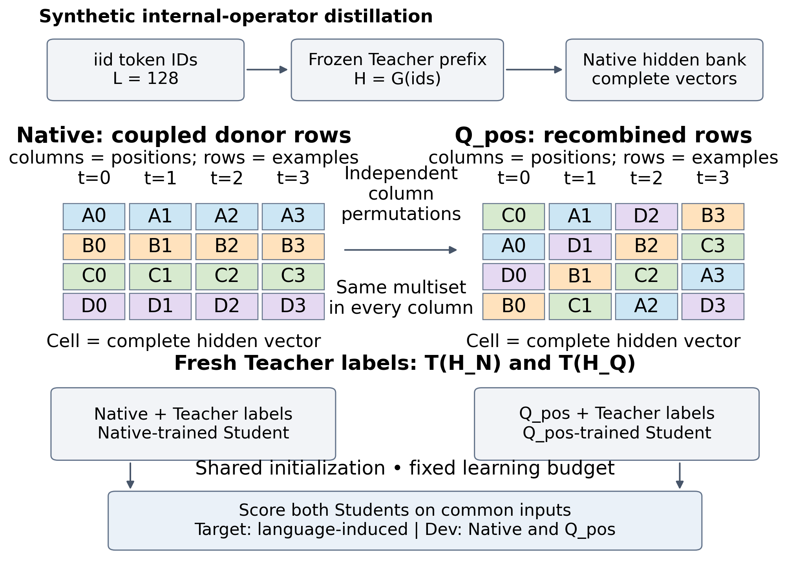
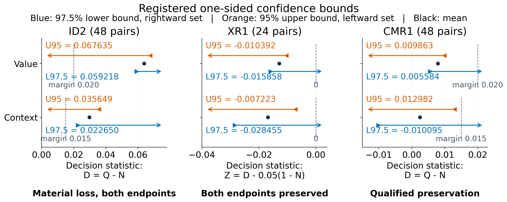
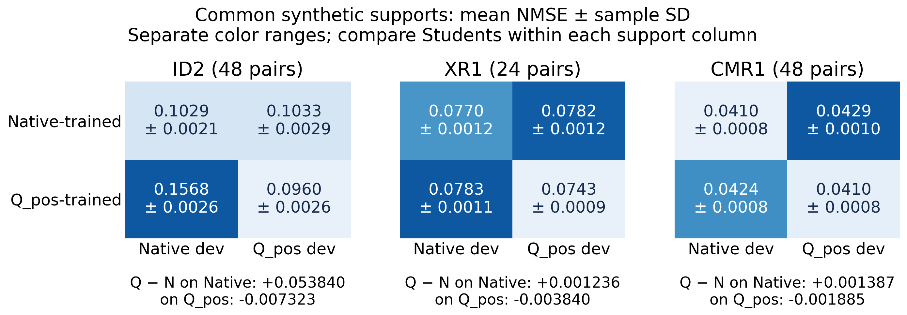

# Marginal-Preserving Support Interventions in Synthetic Transformer-Block Distillation

**Haofeng Hu**  
Tianjin University, Tianjin, China  
Correspondence: 1772027289@qq.com

## Abstract

A Transformer hidden vector can already encode substantial context from earlier layers. How much does its cross-position arrangement matter when a compressed block learns from synthetic hidden sequences? We study this question with Q_pos, a support intervention that independently permutes donor rows at each position while preserving the exact finite empirical multiset of complete hidden vectors. Students learn frozen block residual updates from Native or Q_pos synthetic inputs, with fresh Teacher labels and a fixed paired training procedure. Three separately registered campaigns reveal configuration-dependent effects. At GPT-2 block 5, Q_pos produces material losses on both value and history-response fidelity: mean normalized-error penalties are 0.063807 and 0.029738. GPT-2 block 9 meets its registered 5%-of-Native-recovery preservation rule, and Pythia-160M block 5 meets qualified preservation under absolute margins. Exploratory cross-support evaluation locates the GPT-2 block-5 deficit on independent Native synthetic inputs as well: Native- and Q_pos-trained Students score 0.102917 and 0.156757 on that common support, while their ranking reverses on Q_pos support. The study establishes a controlled empirical failure of marginal sufficiency for one fixed learning configuration, alongside preservation cases, and characterizes the resulting support-conditioned approximations. It shows why evaluating learned operators on common supports is essential to understanding synthetic distillation.

## 1. Introduction

Transformer hidden states carry both local information and context accumulated through preceding layers. A complete vector at one position can therefore contain information about the sequence from which it arose. When such vectors are used to train a compressed downstream block, does preserving every position's empirical vector collection preserve the learning problem sufficiently for transfer, or does their arrangement across positions still matter?

This question has a practical consequence for synthetic block distillation. Hidden states generated by a frozen prefix provide training inputs for approximating an internal operator. Their usefulness may depend on information inside individual vectors, on the grouping of vectors into sequences, and on how a restricted learner uses both. Although marginals do not determine a joint distribution, that mathematical fact does not determine the size of a learning effect in a particular Transformer configuration. The effect requires measurement.

We make this measurement using an exact finite intervention. Native hidden banks are generated by passing iid random token-ID sequences through a frozen Teacher prefix. Q_pos independently permutes donor rows at each sequence position, preserving the entire multiset of hidden vectors in each column. Each vector retains its upstream contextual information; its neighboring vectors generally come from different donors. The Teacher then labels the recombined sequences directly. Paired Students share initialization and a fixed learning budget, so the experiment measures the consequence of changing this organization within a defined learning procedure.

The marginal equality is between the Native and Q_pos **synthetic banks**. Real-language-induced target states provide a separate transfer test. This separation lets us ask whether two synthetic supports with identical position-wise vector collections produce comparably transferable approximations of the same frozen block.

The answer varies across configurations. ID2, at GPT-2 Small block 5, shows material losses in both registered endpoints. XR1, at GPT-2 block 9, retains at least 95% of Native's recovered improvement under its relative criterion. CMR1, at Pythia-160M block 5, achieves qualified preservation under absolute margins. These outcomes identify both a substantive failure case and settings in which recombined supports remain adequate for the registered tolerance.

We further characterize the learned approximations through exploratory cross-support evaluation. Both terminal Students are evaluated on both independent synthetic development banks. In ID2, the Q_pos-trained Student is worse on Native support in all 48 pairs, yet has lower mean error on Q_pos support. Its deficit is thus already visible within the synthetic setting. Own-support fit alone would conceal this reversal of Student ordering.

The study contributes:

1. **Controlled support intervention:** an exact finite position-vector marginal control in Transformer-block distillation, with one formal material-loss case and two conditional preservation cases under fixed learning procedures.
2. **Cross-support characterization:** common-input evidence that the ID2 deficit extends to independent Native synthetic support, together with a support-conditioned ordering of the learned Students.

Synthetic model compression, local operator approximation, and marginal-preserving permutation provide the methodological background. The empirical question here concerns complete position-specific representations, internal residual-update targets, and their learned transfer under controlled recombination.

## 2. Related Work

### 2.1 Synthetic examples and model compression

Learning from a trained model's responses has a long history. TREPAN queries neural networks to extract tree representations [@craven1995trepan]. In *Model Compression*, Buciluǎ et al. compare pseudo-data generators for learning an ensemble's function with a smaller neural network. Their RANDOM generator independently samples attributes from empirical marginals; the ensemble relabels the resulting examples. Comparisons with MUNGE show the relevance of joint structure to transfer [@bucila2006compression]. This establishes the broader connection between synthetic organization and restricted-model learning.

Our experiment brings that connection to a Transformer hidden-state boundary. Its control preserves a finite multiset of **complete vectors** at every position, rather than drawing input attributes independently. Fresh residual-update labels, matched learning procedures, and common-support evaluation make the consequences of this control directly measurable.

### 2.2 Data-free and layer-wise distillation

Data-free distillation synthesizes supervision from information associated with a trained model. Lopes et al. use model metadata, while DeepInversion optimizes synthetic inputs using Teacher statistics [@lopes2017datafree; @yin2020deepinversion]. Horton et al. generate layer-wise feature inputs for local CNN compression [@horton2022layerwise]. Ma et al. synthesize continuous pseudo-embeddings for text-classification distillation [@ma2020asdfd]. These methods establish continuous synthetic inputs and local approximation as natural settings for compression.

Native generation uses a frozen Transformer prefix to construct synthetic sequences from random token IDs. The present experiment keeps the regression objective fixed and changes how its position vectors are grouped. Dependency-aware synthesis is also central to Krukowski et al.'s model-inversion approach to continual learning [@krukowski2026dreams]. Our finite intervention complements such generator studies by controlling exactly which empirical input information is retained.

### 2.3 Permutation and relational distillation

FactorVAE independently permutes latent coordinates across a minibatch to approximate a product of marginals [@kim2018factorvae]. Q_pos applies the same permutation principle to whole position-specific hidden vectors. The grouping unit determines the invariant: all within-vector information and each position's complete empirical vector distribution remain intact.

FitNets supervises intermediate representations, Relational Knowledge Distillation transfers relations among examples, and MiniLMv2 distills internal attention relations [@romero2015fitnets; @park2019rkd; @wang2021minilmv2]. These approaches alter the supervision being transferred. Here, the full-update loss is constant across arms, and the relation being changed is the grouping of positions within an input example.

### 2.4 Fidelity and generalization

Stanton et al. distinguish Teacher fidelity from generalization and show that optimization and distillation data affect the learned match [@stanton2021distillation]. Wu et al. examine fidelity under changes in underlying mechanisms [@wu2024mechanisms]. Distribution-shift and underspecification studies likewise motivate evaluating approximations beyond their training distribution [@sugiyama2007covariate; @ben2010domains; @damour2022underspecification]. Our value, constructed history-response, and cross-support measurements connect these concerns to a controlled internal-block learning task.

## 3. Problem Setup and Support Intervention

### 3.1 Internal operator learning

Let \(G_l(x)\in\mathbb R^{L\times d}\) denote embeddings and all frozen blocks preceding zero-based block \(l\). The selected Teacher block maps \(H\) to \(H+T_l(H)\), where \(T_l\) is its residual update. A compressed Student \(S_\theta\) has the same external width and minimizes

\[
\widehat L_Q(\theta)=\frac{1}{nLd}\sum_{j=1}^{n}\|S_\theta(H_Q^{(j)})-T_l(H_Q^{(j)})\|_F^2.
\]

The learner includes architecture, initialization, optimizer, minibatch schedule, and terminal budget. Support adequacy is evaluated relative to this fixed procedure.

**Native synthetic support \(Q_N\).** Token IDs are sampled iid uniformly with replacement and passed through \(G_l\) in evaluation mode. GPT-2 uses all 50,257 embedding-row IDs; Pythia uses its frozen tokenizer-accepted domain. Causal prefix computation couples the resulting vectors. Positional information follows each family's original machinery; GPT-2 position embeddings are not added again at the block boundary.

**Target support \(P_l\).** Natural-language windows passed through the same prefix induce the target hidden states. These states evaluate synthetic-to-target transfer. The Teacher is pretrained on language, while Student training uses the synthetic banks.

### 3.2 Exact finite position-vector preservation

For a Native bank \(H_N\) with \(n\) rows, independently draw a uniform permutation \(\pi_t\) of row indices at each position \(t\), and define

\[
H_Q[j,t]=H_N[\pi_t(j),t],\qquad Y_Q[j]=T_l(H_Q[j]).
\]

For every position,

\[
\{H_Q[j,t]:j=1,\ldots,n\}=\{H_N[j,t]:j=1,\ldots,n\}
\]

as multisets. This preserves multiplicity, full-vector support, and every statistic determined by the empirical column. The permutations are independent across positions and allow donor coincidences. Train, dev, and audit banks use separate frozen random roles.

Q_pos changes finite row coupling while retaining contextual information inside each vector. It is a finite recombination, rather than an exact population product distribution. Fresh labels incorporate the Teacher's response to the new arrangement. The treatment therefore includes any resulting changes in supervision, approximation, and optimization.

**Figure 1. The controlled support intervention.** Random token IDs pass through a frozen prefix to form Native hidden sequences. Independent row permutations at each position reassign complete vectors while preserving every column multiset. Both banks receive fresh Teacher residual-update labels and train paired Students. Target evaluation uses real-language-induced inputs; exploratory cross-support evaluation uses independent Native and Q_pos dev banks. The four-row example is schematic.

### 3.3 Serial and parallel block updates

Including each branch's normalization and projections, GPT-2 has the serial update

\[
T(H)=A_T(H)+M_T(H+A_T(H)),
\]

and the selected Pythia block has parallel branches

\[
T(H)=A_T(H)+M_T(H).
\]

Students follow their respective Teacher topology. A history change at a fixed query can affect GPT-2's MLP through the attention intermediate state. Pythia's MLP reads only the current input vector, so this branch is invariant under that intervention. These structures guide the supplementary response analysis.

## 4. Experimental Protocol

### 4.1 Configurations and training

Table 1 summarizes the formal campaigns using GPT-2 and Pythia Teachers [@radford2019gpt2; @biderman2023pythia]. Within a pair, the two Students share initialization, donor-bank identity, and minibatch indices. All run exactly 10,000 optimizer updates, with terminal checkpoints used for formal evaluation.

**Table 1. Formal configurations.** Block indices are zero-based. Tolerances list Value / Context. Target windows are distinct across campaigns.

| Property | ID2 | XR1 | CMR1 |
|---|---|---|---|
| Teacher / block | GPT-2 Small / 5 | GPT-2 Small / 9 | Pythia-160M / 5 |
| Prefix blocks | 0-4 | 0-8 | 0-4 |
| Topology / activation | serial / gelu_new | serial / gelu_new | parallel / gelu |
| Positions | learned absolute | learned absolute | RoPE |
| Student / Teacher block parameters | 3,546,240 / 7,087,872 | same | same |
| Paired replicates | 48 | 24 | 48 |
| Length / residual width | 128 / 768 | same | same |
| Train / dev / audit rows | 4096 / 256 / 512 | same | same |
| Target windows per environment | 1024 | 1024 | 1024 |
| Registered tolerance | absolute 0.020 / 0.015 | 5% of Native recovery | absolute 0.020 / 0.015 |

Teachers have 12 attention heads of width 64 and an MLP width of 3072. Students have six heads of width 64, internal attention width 384, MLP width 1536, and residual width 768. Projection weights are independently initialized with standard deviation 0.02, biases are zero, normalization scales/biases are one/zero, and dropout is disabled.

The shared recipe uses AdamW (betas 0.9/0.999, epsilon \(10^{-8}\), weight decay 0), peak learning rate \(10^{-3}\), 200-step warmup, cosine decay to \(10^{-4}\), gradient clipping at 1, and effective batch 32 from four microbatches of eight. The deterministic FP32 configuration disables AMP and TF32 and preserves family-specific masks and positional interfaces.

### 4.2 Value and history-response endpoints

For environment \(k\), Value is

\[
R_k(S)=\frac{\sum_{H\in P_k}\|S(H)-T(H)\|_F^2}
{\sum_{H\in P_k}\|T(H)\|_F^2},\qquad R(S)=\frac13\sum_{k=1}^{3}R_k(S).
\]

The C4, peS2o, and StackExchange environments receive equal weight after separate normalization. A zero-update predictor has Value 1.

Context measures fidelity to a constructed history replacement. At queries \(t\in\{63,127\}\), earlier positions \([0,t)\) are replaced by a frozen independent nonself donor; the query and later positions are fixed. Define \(\Delta T_t=T(H')_t-T(H)_t\) and similarly \(\Delta S_t\). The formal endpoint is

\[
C(S)=\frac13\sum_k\frac12\sum_{t\in\{63,127\}}
\frac{\sum_{H\in P_k}\|\Delta S_t-\Delta T_t\|_2^2}
{\sum_{H\in P_k}\|\Delta T_t\|_2^2}.
\]

Context thus evaluates a controlled functional response, including potentially off-manifold splices, rather than ordinary semantic understanding. A deterministic token-wise Student has Context 1 when the response denominator is nonzero. Pythia's fixed-query MLP response cancels; GPT-2's serial MLP can participate. Earlier Silent Teacher/ID1 Context scores pooled the two queries before division and are reported separately in Appendix B.

For each endpoint, let \(N_i,Q_i\) be the Native- and Q_pos-trained Student scores, and \(D_i=Q_i-N_i\). Positive D favors Native. Paired replicates are the inferential units. Bounds condition on the realized frozen target ledger and exclude corpus-sampling uncertainty.

### 4.3 Registered decision rules

The one-sided bounds are \(U_{95}(X)=\bar X+t_{.95,m-1}s_X/\sqrt m\) and \(L_{97.5}(X)=\bar X-t_{.975,m-1}s_X/\sqrt m\). Each campaign retains its own rule:

- **ID2:** absolute margins \(\delta_R=0.020\), \(\delta_C=0.015\). Either \(L_{97.5}(D)>\delta\) establishes material loss; both \(U_{95}(D)<\delta\) establish preservation. Native upper 95% bounds are checked against historical reference thresholds 0.674317 / 0.721632, with the registered material-loss precedence.
- **XR1:** \(G_i=1-N_i\) and \(Z_i=D_i-0.05G_i\). Native requires both \(L_{95}(G)>0.20\). Conditional on qualification, both \(U_{95}(Z)<0\) establish relative preservation; either \(L_{97.5}(Z)>0\) establishes relative loss. Pair-level Z retains the variance of recovery and penalty together.
- **CMR1:** Native also requires both \(L_{95}(G)>0.20\), while loss/preservation use ID2's absolute margins. Preservation under qualification yields its qualified terminal outcome.

The 97.5% lower bounds protect an either-endpoint loss claim across two endpoints; preservation requires both upper-bound conditions. Across campaigns, comparisons are descriptive because blocks, models, supports, ledgers, and in some cases decision scales differ. There is no registered common cross-campaign significance test.

### 4.4 Research sequence and evaluation identity

Early Silent Teacher work used WikiText and PG-19 development/validation data, followed by a held-out PG-19 confirmation. These outcomes informed the later intervention sequence. ID1, ID2, XR1, and CMR1 then froze separate construction rules, random roles, target ledgers, and scientific decisions. Each formal Q_pos ledger contains 3072 length-128 windows, with predecessor exposure excluded from the three known source families. Registration here refers to the archived campaign-specific scientific freeze.

Execution amendments and exposure boundaries are documented in Appendix A, including a feasibility evaluator repair after Value outcomes, ID1 repeat evaluation, ID2 analysis recovery, XR1 orchestration repair, and CMR1 prefreeze control and metadata-access incidents. The appendix identifies the relevant scientific conditions and retained result identities.

### 4.5 Exploratory common-support evaluation

After the formal results, both terminal Students were scored on both original independent dev banks (256 rows, length 128). Each support column supplies identical hidden inputs, direct Teacher labels, and a common Teacher-energy denominator to both Students. All 480 cells across 120 pairs were recomputed, with historical own-support scores used as identity checks. Same-column paired comparisons are central because the two supports have different denominators. This post-outcome diagnostic complements the formal target results.

## 5. Results

### 5.1 Feasibility and the earlier intervention

Silent Teacher established partial synthetic-to-target fidelity at GPT-2 block 5 in three held-out PG-19 seeds. Native target Value was 0.666047-0.698391; the tested Gaussian boundary control scored 2.895546-3.213844 despite own-audit Value 0.267775-0.287701. Native also had lower Context and predictive KL than Gaussian. These results motivate examining the organization of Teacher-derived synthetic inputs. Appendix B retains all seeds and the contrasting token-wise and parameter-copy controls.

ID1 compared coherent upstream token-half splicing with composite separately computed hidden halves. Across 24 pairs, its mean Value penalty was 0.003801 (SD 0.005386), below the registered 0.05 materiality threshold. Q_pos subsequently introduced exact finite column control, whereas ID1 preserved a construction-level sampling law. Their different controls motivate treating the two interventions separately.

### 5.2 Formal Q_pos outcomes

Table 2 reports all formal continuous effects, and Table 3 gives the decision evidence. Preservation cases have positive average penalties within their registered tolerances.

**Table 2. Formal target fidelity.** N/Q are mean Student scores; D is the paired Q-minus-N penalty. SD(D) is across replicate pairs. All values are normalized under the endpoint definitions in Section 4.2.

| Study | Endpoint | Pairs | N | Q | Mean D | SD(D) | D > 0 |
|---|---|---:|---:|---:|---:|---:|---:|
| ID2 | Value | 48 | 0.659816 | 0.723623 | 0.063807 | 0.015806 | 48/48 |
| ID2 | Context | 48 | 0.710719 | 0.740457 | 0.029738 | 0.024408 | 43/48 |
| XR1 | Value | 24 | 0.487372 | 0.500135 | 0.012763 | 0.007231 | 24/24 |
| XR1 | Context | 24 | 0.605316 | 0.608207 | 0.002891 | 0.028016 | 15/24 |
| CMR1 | Value | 48 | 0.314554 | 0.322472 | 0.007917 | 0.008034 | 40/48 |
| CMR1 | Context | 48 | 0.412340 | 0.414828 | 0.002488 | 0.043333 | 28/48 |

**Table 3. Registered decision evidence.** Entries give Value / Context. Loss uses one-sided 97.5% lower bounds; preservation uses one-sided 95% upper bounds. Qualification is a separate requirement. XR1's decision variable is Z; ID2/CMR1 use D.

| Study | Native qualification | Loss / preservation bounds | Terminal outcome |
|---|---|---|---|
| ID2 | U95(N) = 0.662511 / 0.716535 < 0.674317 / 0.721632 | L97.5(D) = 0.059218 / 0.022650 > margins 0.020 / 0.015; U95(D) = 0.067635 / 0.035649 | Material loss, both endpoints |
| XR1 | L95(G) = 0.510848 / 0.388770 > 0.20 | U95(Z) = -0.010392 / -0.007223 < 0; L97.5(Z) = -0.015858 / -0.028455 | Both endpoints preserved |
| CMR1 | L95(G) = 0.684391 / 0.580793 > 0.20 | U95(D) = 0.009863 / 0.012982 < margins 0.020 / 0.015; L97.5(D) = 0.005584 / -0.010095 | Qualified preservation |

ID2's loss exceeds both absolute margins. Complete position-wise vector collections therefore do not preserve target fidelity adequately for this block-5 learner under the fixed budget. XR1 passes qualification and relative preservation; its mean penalty is 2.49% of mean Native recovery for Value and 0.73% for Context. CMR1 qualifies and passes absolute preservation in another Teacher family. The combination of outcomes makes the empirical dependence on row organization configuration-specific.

**Figure 2. Formal decisions on their registered scales.** Each column is one campaign. Black points show the mean decision statistic. Blue rightward arrows start at its one-sided 97.5% lower bound; orange leftward arrows start at its one-sided 95% upper bound. The two arrows represent separate one-sided confidence sets, not a combined two-sided interval. Dashed lines mark the decision boundary: D margins 0.020 / 0.015 for ID2/CMR1 (Value / Context), and zero for XR1's Z = D - 0.05(1 - N). Material loss requires a lower bound above the boundary for either endpoint; preservation requires upper bounds below it for both endpoints, with Native qualification satisfied as shown in Table 3. All means and bounds are copied from the existing formal records. The column-specific scales preserve the different registered questions.

### 5.3 Cross-support characterization

Common-support scoring reveals how the two Students' approximation quality depends on their inputs (Table 4). The diagonal scores reproduce historical dev values within \(10^{-9}\), while the off-diagonal scores expose behavior that own-support evaluation cannot show.

**Table 4. Exploratory common synthetic-support matrix.** Mean ± sample SD across all formal pairs. Students in a column share inputs, Teacher labels, and denominator; Native and Q_pos columns have different Teacher energies.

| Study | Student | Native dev | Q_pos dev |
|---|---|---:|---:|
| ID2 | Native-trained | 0.102917 ± 0.002054 | 0.103293 ± 0.002937 |
| ID2 | Q_pos-trained | 0.156757 ± 0.002625 | 0.095970 ± 0.002594 |
| XR1 | Native-trained | 0.077021 ± 0.001166 | 0.078161 ± 0.001187 |
| XR1 | Q_pos-trained | 0.078257 ± 0.001059 | 0.074322 ± 0.000915 |
| CMR1 | Native-trained | 0.041004 ± 0.000847 | 0.042914 ± 0.001015 |
| CMR1 | Q_pos-trained | 0.042392 ± 0.000814 | 0.041029 ± 0.000795 |

On Native dev support, ID2's paired Q-minus-N difference is +0.053840 (SD 0.002857), positive in all 48 pairs. On Q_pos dev support it is -0.007323 (SD 0.003491), positive in only one pair. The Q_pos Student's deficit consequently extends to independent Teacher-derived synthetic inputs. It cannot be described solely as a failure that emerges when moving to language-induced states.

XR1 and CMR1 also reverse their mean Student ordering across support columns. Their Native-column penalties are +0.001236 and +0.001387, and their Q_pos-column differences are -0.003840 and -0.001885. ID2's Native-column discrepancy is descriptively larger. These common-input comparisons establish support-conditioned approximations; differences in Teacher and scale remain part of the cross-configuration comparison.

**Figure 3. Common-support Student ordering.** Rows identify the Student's training support; columns identify its independent evaluation support. Cells give mean NMSE ± sample SD, and the lower annotations give paired Q-trained-minus-N-trained differences by column. Panel colors use separate ranges. Within-column comparisons share a Teacher-energy denominator. The matrix is an exploratory synthetic diagnostic using all original formal replicates.

Own-support diagonals compare different input-label distributions. The matrix instead answers which Student better approximates the Teacher on the same inputs. The ID2 Native-dev penalty +0.053840 and its formal target Value penalty +0.063807 are measurements on different distributions, rather than terms in a numerical loss decomposition.

### 5.4 Functional characterization

Supplementary donor-aligned measurements hold the query vector and position fixed while replacing its historical combination. ID2's Q_pos Student has relative Teacher-response error 0.477392 versus 0.252638 for the Native Student; XR1 and CMR1 lack this Q_pos disadvantage. ID2 has the highest relative Teacher response energy, while XR1 has the highest raw energy. Error decompositions reveal substantial branch compensation, and fixed short continuation modifies response reproduction and final error in partially different ways. Appendices D-E give these exploratory measurements and their algebraic definitions.

## 6. Discussion

### 6.1 Context inside vectors and organization across vectors

Q_pos retains all empirical information available within a single position vector. ID2 nevertheless incurs material target penalties, showing that the downstream learning procedure benefits from Native cross-position organization beyond that retained information. XR1 and CMR1 show that the size of this benefit is not uniform: their approximations meet the corresponding preservation criteria. Together, the results make the practical question sharper than the abstract observation that marginals leave a joint distribution unspecified. What matters empirically is how much the changed joint organization affects a given learner's fidelity.

The treatment changes input arrangement and recomputed labels together. Its measured effect belongs to the complete support-and-supervision construction under the fixed learner. Moving between campaigns also changes the block, prefix-induced support, and, for CMR1, model family and Student topology. The preservation cases therefore describe tested configurations rather than isolate a single architectural cause.

### 6.2 Common support locates the discrepancy

Cross-support scoring changes the interpretation of ID2. The Q_pos Student is relatively successful on its own independent support, but substantially worse on Native synthetic inputs. This places part of the approximation problem before the additional shift to natural-language-induced states. It also explains why diagonal dev scores offer an incomplete picture: two learned functions can have favorable scores on different supports and reverse order under common-input evaluation.

This characterization focuses future explanation on the relationship between training supervision and the behaviors required on Native support. Finite optimization, inductive bias, capacity, and support-specific constraints can all affect that relationship. The current evidence identifies where the approximation differs more clearly than why it differs.

### 6.3 What the supplementary diagnostics resolve

Teacher history sensitivity, Student response reproduction, and final output error measure different aspects of the learning problem. The response defect gives a functional description of ID2's Q_pos approximation. The exact decompositions show why attributing total error to one positive branch norm is misleading: negative inner products offset substantial branch errors, and ID2's net propagation-associated change is negative despite an increased propagation norm.

Short continuation adds a local intervention on learning. Extra pure Q_pos training modestly improves the historical Q Student on Native audit; a 10% Native loss weight improves it more relative to the same-start pure continuation. Starting-point differences persist after 1000 matched-compute updates. Moreover, the Native-start mixed branch improves response reproduction while slightly worsening Native audit from baseline. Functional improvement and final-error improvement are thus separable, and these diagnostics do not identify a causal mediator. Appendix F separates Teacher history sensitivity from support dependence in a restricted-Student example.

## 7. Limitations

The study covers three formal configurations, two Teacher families, length 128, and one compressed width recipe under finite budgets. It establishes configuration-specific outcomes, with convergence and broader architecture coverage remaining open. Normalized fidelity measures depend on their Teacher energies and aggregation; raw and relative response energies answer different scaling questions.

Target inference conditions on fixed ledgers from known source families. Early development informed subsequent campaign choices, and fresh window identities do not establish domain novelty or absence from Teacher pretraining. StackExchange may overlap Pythia's pretraining sources. The independent synthetic matrices, functional diagnostics, and continuation were conducted after formal outcomes and support descriptive interpretation. Their recorded supports, positions, and scheduled time points are retained in the supplements.

## 8. Conclusion

Complete finite position-vector marginal preservation can coexist with substantial losses in Transformer-block learning and transfer. ID2 demonstrates that failure under a fixed compressed learner, while XR1 and CMR1 provide conditional preservation cases. Cross-support evaluation further exposes a Native synthetic deficit and a reversal of Student ordering across supports. The combination makes synthetic support organization an empirically consequential, configuration-dependent aspect of internal-operator distillation and establishes common-support evaluation as a clear way to characterize the learned approximations.

## Generative AI assistance

Generative AI tools, including OpenAI Codex and other language-model assistants, substantially assisted research planning, experimental and analysis code development, literature organization, and manuscript drafting and revision. The author retains responsibility for the scientific content, verification of results and references, and the final manuscript.

## Code and data availability

Code, selected machine-readable results, manuscript sources, and figure-regeneration tools are publicly available at [the LatentBridge repository](https://github.com/P1g0d/latentbridge-synthetic-support). Software version 0.1.0 identifies the public snapshot. Original software is licensed under MIT; the manuscript, figures, and authored result documents are licensed under CC BY 4.0. The archive supports inspection of recorded results and figure regeneration. Model weights, language corpora, target arrays, and historical Student checkpoints are not redistributed, so the archive does not provide a turnkey rerun of the historical campaigns. Appendix A identifies the result versions and scientific provenance.
